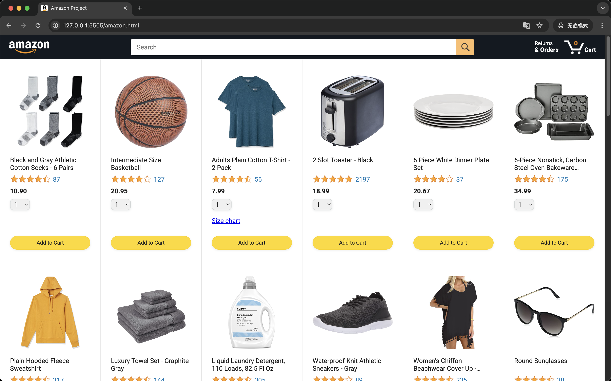
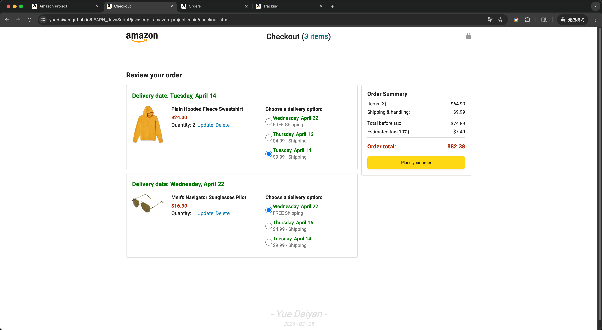
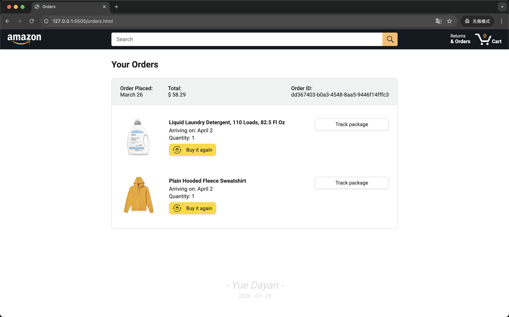
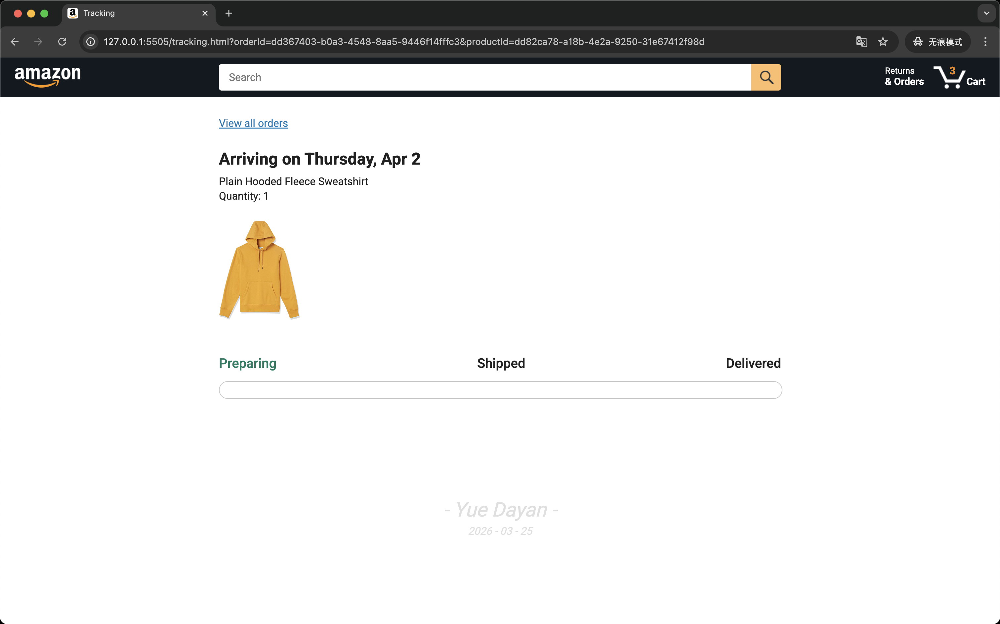
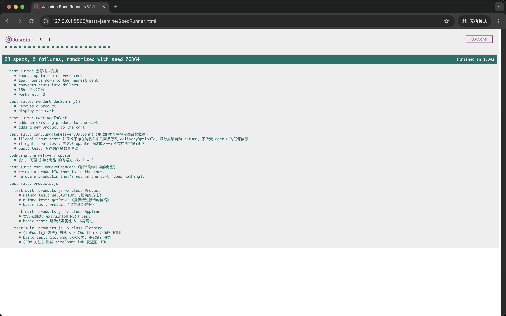

# Javascript Course: Amazon Clone

This repository documents my progress through a JavaScript course, including assignments and the final project. 
Topics covered include DOM manipulation and interaction, state management, procedural and object-oriented programming, the Jasmine testing framework, and asynchronous programming (XMLHttpRequest, Fetch API, async/await).

<small>本仓库记录了我学习 JavaScript 课程的过程，包括作业与最终项目。</small>  
<small>课程内容涵盖 DOM 操作与交互、状态管理、过程式编程与面向对象编程、Jasmine 测试框架，以及异步编程（XMLHttpRequest、Fetch API、async/await）。</small>

##  Final Project
* **File Path:** `/javascript-amazon-project-main`
* **Best Viewed In:** Google Chrome

 

        

[page 1 amazon.html](https://yuedaiyan.github.io/LEARN_JavaScript/javascript-amazon-project-main/amazon.html)

        

[page 2 checkout.html](https://yuedaiyan.github.io/LEARN_JavaScript/javascript-amazon-project-main/checkout.html)

        

[page 3 orders.html](https://yuedaiyan.github.io/LEARN_JavaScript/javascript-amazon-project-main/orders.html)

        

[page 4 tracking.html](https://yuedaiyan.github.io/LEARN_JavaScript/javascript-amazon-project-main/tracking.html)

 

        

[Jasmine Test Framework (Must use Chrome on the computer)](https://yuedaiyan.github.io/LEARN_JavaScript/javascript-amazon-project-main/tests-jasmine/SpecRunner.html)

 

##  Resources & Credits
* **Course Video:** [JavaScript Tutorial Full Course - Beginner to Pro](https://www.youtube.com/watch?v=EerdGm-ehJQ&t=61267s)
* **Assignments:** [Course Repository](https://github.com/SuperSimpleDev/javascript-course)
<!-- * **Reference Example:** [Live Demo](https://supersimple.dev/exercises/amazon/) -->

---
*Completed as part of my Front-End development learning journey.*